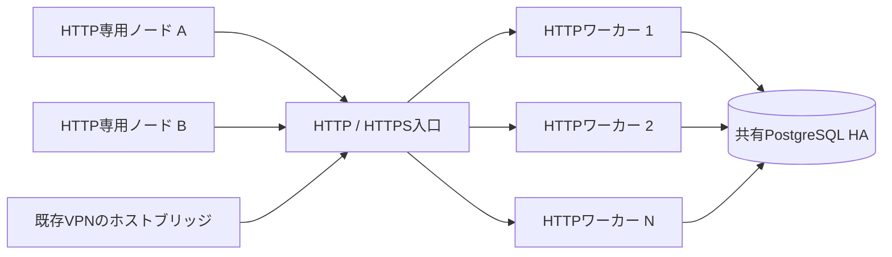

# HTTPだけで接続するノードと水平スケール

HeteroNetworkのHTTPメッシュは、HTTPリクエストごとに別のワーカーへ振り分けられても動くVPN転送経路です。アプリのコンテナは外向きのHTTPSだけで参加でき、公開IP・UDPの待ち受け・TUN・root・NET_ADMINを必要としません。

## 起動

`clients/headless`のCLI/Go SDKを使用します。イメージのビルド・検証・発行は`HTTP transport fallback` Actionsの`publish-headless`ジョブが行います。発行済みのコミットタグか、そのジョブに記録されたダイジェストを固定してください。

```sh
cd clients/headless
go build -mod=readonly -o heteronet-headless ./cmd/heteronet-headless
export HETERONETWORK_ENDPOINT=https://YOUR_CONTROL_ORIGIN
# 参加トークンを0600のファイルへ配置。値をシェル履歴・URLに入れない。
export HETERONETWORK_JOIN_TOKEN_FILE=/run/secrets/heteronet-join.json
./heteronet-headless --publish 8081=127.0.0.1:3000
```

ローカルのアプリの3000番ポートを、そのノードのVPN IPの8081番として公開します。外部のHTTP入口に公開されるのは`/healthz`と`/readyz`だけです。アプリのコンテナ自身が公開するHTTP入口は不要です。`--publish-udp`も使えます。VPN内のUDPパケットも外側はHTTPで運びます。

同じネットワーク名前空間で動かすサイドカー、またはCLIの`-- APP ARG...`で起動したアプリから、`127.0.0.1:1080`のSOCKS5を使って他のVPN IPへ接続できます。子プロセスには参加トークンとノード秘密鍵を渡しません。CLIは登録したノードIDとVPN IPを起動時に出力し、子には`HETERONETWORK_NODE_ID`、`HETERONETWORK_VPN_IP`を渡します。

Goアプリは`headless.Start`、`Node.DialContext`、`ListenTCP`、`ListenUDP`を直接利用できます。DNS名の解決を伴わないVPN IPまたはノードIDで宛先を指定します。SOCKSの名前も登録済みノードIDとして解決されます。

既定ではインスタンスごとに別のEd25519鍵・WireGuard鍵・VPN IPを作ります。正常終了で登録を削除し、強制終了時は最後のポーリングから5分後、最大約30秒の清掃待ちを経て自動削除します。固定IDが必要なら`HETERONETWORK_IDENTITY_KEY`と`HETERONETWORK_WIREGUARD_PRIVATE_KEY`を両方渡します。固定IDの登録は期限切れで削除しません。**複数インスタンスで同じ鍵を共有しないでください。**

## HTTPワーカーを増減する



ワーカーは既存の`iparsd control-plane`です。同じクラスター設定と共有PostgreSQLへ接続させ、L7ロードバランサーで振り分けます。スティッキーセッション、特定ワーカーへのソケット所有権、ワーカー間の直接UDP通信は不要です。SQLiteは開発・単一ホストの検証用です。

- `GET /v1/transport-capabilities`: `http_mesh_protocol: 1`を確認。
- `POST /v1/http-mesh/join`: 通常の署名付き参加トークンで登録。全ノードのpeer mapを返しません。
- `POST /v1/http-mesh`: ノード署名・操作本文へのコミットメント付きの`lease`、`peer`、`routes`、`send`、`poll`、`leave`。
- 管理APIと管理コンソールの「通信方式 → HTTPメッシュ」: 最終ポーリング、送信・受信バイト、未配信バイト・バッチ数。

参加・鍵の取得にはHTTPSを必須にしています。`HETERONETWORK_HTTP_MESH_ENDPOINT=http://YOUR_PACKET_ORIGIN`を別に設定すると、暗号化パケットと署名済みポーリングを80番のHTTP入口へ送れます。参加トークンや信頼する公開鍵を平文HTTPから取得しません。登録後も新しい相手の鍵の取得にはHTTPSを使用します。

受信は各ノード1本の最大10秒のロングポーリングです。入口の応答タイムアウトは25秒以上にしてください。PostgreSQLのNOTIFYで待機を解除し、通知を失った場合も1秒周期の再確認で復旧します。待機中にDB接続を占有しません。セッションとWireGuard秘密鍵は参加ノードにあり、HTTPワーカーとDBにはアプリの平文を置きません。

登録時に全ノード分の接続やpeer mapを作りません。VPN IPは一意制約で保護した疎な割り当て、相手の検索はIP/IDによる遅延取得です。接続状態は実際に通信する相手の数に比例します。物理ホストのブリッジは、HTTP専用ノードの経路を50件ずつ取得して保持します。

共有DB・入口の帯域やクォータには容量限界があります。受信キューはノード当たり8 MiB/256バッチ、1バッチ64 KiB/32パケット、期限120秒に制限し、満杯の場合はHTTP 429でバックプレッシャーをかけます。ノード側も送信キュー・接続並列数を制限します。遅延と帯域が重要なホストでは、既存のUDP経路を使えます。

ACK前のパケットは再取得でき、送信結果が失われた場合は同じバッチIDで再送します。ACK後も期限内の重複排除情報を保持します。署名のリプレイ排除も共有DBで行うため、別レプリカへの再送で認証を回避できません。ノード停止指定・クラスター分離・既存ACLを送受信の両方で適用します。ホストブリッジは復号した内側の送信元・宛先にも制御プレーンの転送許可を要求し、未登録の下位ネットワークIPや、許可されていない他のクライアントへの転送を拒否します。転送許可のキャッシュは最大5秒です。

## 既存VPNとつなぐ物理ホスト

Linuxの物理VPNホストでのみ、CLIの`--kernel-interface hnhttp0`を使います。このモードはTUNとNET_ADMINが必要です。既存エージェントと同じ**そのホストの**登録ID・鍵を使い、HTTP専用ノードへの/32経路だけを専用テーブル51989、優先度19780に追加します。他のホストの鍵は複製しません。メインテーブル・デフォルトルート・既存WireGuardデバイスを変更しません。

ホスト間のルーティングとファイアウォールで`hnhttp0`から既存VPNへの転送が許可されている必要があります。ブリッジを経由するクライアントの送信元IPは、制御プレーンから取得した、そのゲートウェイ配下のACLで許可されたIPだけをWireGuard AllowedIPsに追加します。

ネイティブサーバーの段階更新は`deploy/http-mesh/native-rollout.yaml`、ブリッジのインストールは`deploy/http-mesh/host-bridge.yaml`です。どちらも宣言したSHA-256を確認し、停止指定ホストを除外します。通常のエージェント状態ファイルからローカルで鍵を読み、ネットワークに秘密鍵を送らず、ホストの永続登録を削除しない構成です。登録されたWireGuard鍵のローテーションを検知するとプロセスが終了し、systemdがローカルの新しい鍵で再起動します。

## クラウドへの配置

配置例は`deploy/http-mesh/`にあります。アカウント・課金対象リソースを自動作成した実績を表すものではありません。接続先、既存ネットワーク、シークレット参照、テスト済みイメージを指定して適用します。アプリを一緒に動かす場合は、このCLIを組み込んだイメージかサイドカーを使用してください。

| 環境 | 配置設定 | 継続接続の設定 |
|---|---|---|
| Cloud Run | `cloud-run/main.tf` | CPU常時割当、min=1、内部入口、Secret Manager参照 |
| ECS Fargate | `ecs/main.tf` | 非特権、全capability削除、タスクを1〜10にスケール、Secrets Manager/SSM参照 |
| Cloudflare Containers | `cloudflare/` | 名前ごとに別コンテナ、休止タイマー延長、管理操作は認証後に実行 |

Cloud Runでは、VPNへの着信だけではスケールゼロからアプリを起動できません。継続して受信するアプリはmin=1以上・CPU常時割当が必要です。水平スケールで生まれた個々のノードは別IPになるため、アプリの負荷分散にはサービス側のディスカバリー/LBを使います。1個のVPN IPに複数のWireGuard状態を重ねる方式ではありません。

Cloudflareの設定では`HETERONETWORK_ENDPOINT`とイメージを変更し、`HETERONETWORK_JOIN_TOKEN`、32文字以上の`MANAGEMENT_TOKEN`をWranglerのsecretとして保存します。設定ファイルの`vars`やTerraformの変数には秘密の値を入れません。管理用のWorkerルートを割り当て、`PUT /nodes/INSTANCE_NAME`で開始、`GET`でready確認、`DELETE`で停止します。名前を変えると別ノードです。管理トークンがない公開アクセスではコンテナを起動しません。最大インスタンス数はWranglerの`max_instances`で制限します。

ECSのサブネットにはHTTPSへの外向き経路が必要です。実行ロールに指定のシークレット取得とイメージ取得・ログ書き込みだけを許可し、ノード用のWAN受信ルールは不要です。Cloud Runのサービスアカウントは指定の参加トークンのみを取得できます。

公式仕様: [Cloud Runのコンテナ契約](https://docs.cloud.google.com/run/docs/container-contract)、[Fargateのセキュリティ](https://docs.aws.amazon.com/AmazonECS/latest/developerguide/fargate-security-considerations.html)、[Cloudflare Containerクラス](https://developers.cloudflare.com/containers/api/container-class/)。

## 検証

Actionsの`HTTP transport fallback`は、実際のRust制御プレーンを共有PostgreSQLへ接続し、実際のWireGuard/gVisor TCP/IPスタックで次を検証します。

1. HTTPワーカー3→5→2→3の増減・再起動中のTCPとUDP通信。
2. DBコミット直後の応答喪失・再送・重複排除・共有された利用量。
3. 非root・Linux capabilityなし・OS UDPソケット拒否・TUN作成拒否の環境での同じVPN通信。
4. 通常のLinuxホストのTCPとHTTP専用ノード間の双方向通信、終了時の経路削除。
5. 1000個の異なるノードIDでの登録・署名付きポーリング。1000台分の同時通信帯域測定ではありません。
6. 期限切れの一時ノードのみ削除し、固定・停止指定・更新済みノードを保持。

このE2Eは上記の制約とプロトコルの検証です。各クラウドアカウントでの本番配置検証とは区別します。
